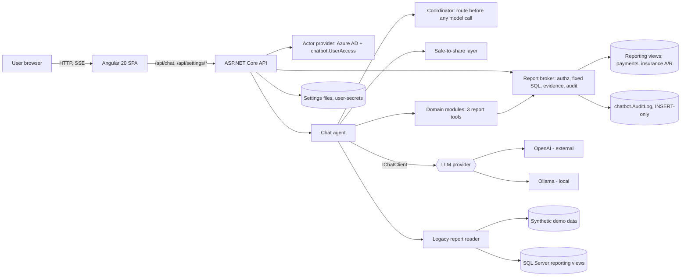
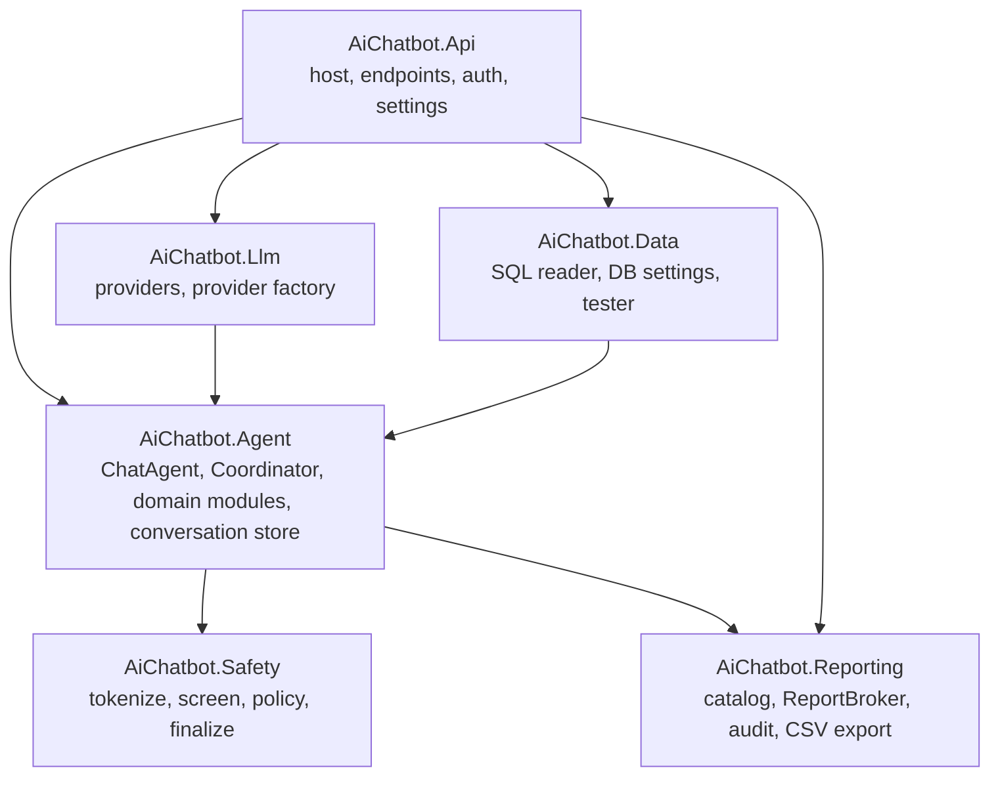
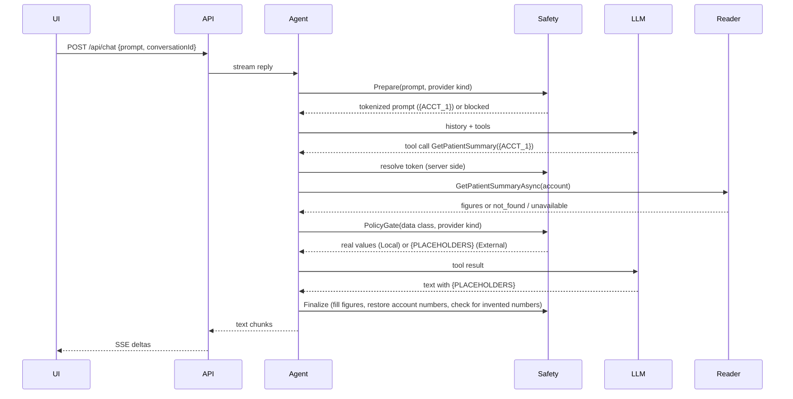

# Architecture

A chat application that answers questions about report data (patient summaries, facility metrics) with an LLM,
without letting identifiers or patient-level values reach an external model.

Related: [SQL_Reporting_Query_Layer.md](SQL_Reporting_Query_Layer.md) (data access rules),
[Data_Dictionary.md](Data_Dictionary.md) (view contract).

## 1. Goals and constraints

| Goal | Consequence for the design |
|---|---|
| Answer data questions in plain language | The LLM calls fixed tools; it never writes SQL. |
| Keep identifiers and patient-level values away from external models | One enforcement layer (Safety) in front of every model call, outside the UI and outside the prompt. |
| Swap model and data source without code changes | Provider and data source are chosen at runtime from a settings screen. |
| Small, auditable surface | Four libraries with one job each, one API host, one SPA. |

Target design: [rcm-ai-chatbot-project-architecture (1).md](<rcm-ai-chatbot-project-architecture (1).md>) and
[Target_Diagram.md](Target_Diagram.md). This file describes what exists today.

Non-goals today: multi-tenant isolation, horizontal scale, patient-level reporting (see section 9).

## 2. System context

The Step 1 diagram (User Interface → API → Agent → LLM) is the spine. Safety, tools and data sit inside the agent's
boundary; settings sit beside the API.

## 3. Components and dependencies

| Project | Responsibility | Does not do |
|---|---|---|
| **Client** (Angular, standalone components, signals) | Chat view, streaming render, settings dialog (AI model, Database tabs). | Hold secrets or rules. The browser is untrusted. |
| **AiChatbot.Api** | HTTP surface: `/api/chat` (NDJSON), `/api/reports/*`, protected `/api/settings/*`, `/api/health`; sign-in and `IActorProvider`; composition root (DI); startup guards. | Business rules. |
| **AiChatbot.Agent** | `ChatAgent` tool loop, `DecisionEngine` (memory questions, clarifying questions, patient lookup, report routing), `ISessionMemory`, `Coordinator` routing (Single / Multi / Open / Patient / Unsupported, max `MaxToolCalls`=6), `IDomainModule` tool contracts (payments, A/R, claims, denials), `RcmReportTools`, per-user `ConversationScope`, conversation history, legacy `ReportTools` demo path. | Talk to a specific vendor or database. |
| **AiChatbot.Reporting** | Report catalog (draft aggregate reports, grouped reports and the chat-only patient billing balance), knowledge layer (glossary, playbooks), small-cell rule, `ReportBroker` (actor + practice scope, role check, fixed parameterized SQL, evidence), audit queue to `chatbot.AuditLog`, CSV export. | Depend on other projects. Accept SQL or caller text in queries. |
| **AiChatbot.Llm** | `IChatClient` per provider, provider-kind classification, saved provider settings, model discovery. | Decide what data may be sent. |
| **AiChatbot.Safety** | Tokenization, input screen, policy gate, placeholder rendering, streaming finalizer. | Know about HTTP, vendors or SQL. |
| **AiChatbot.Data** | SQL reader over two views, DB settings (encrypted), connection tester, live-switchable reader. | Accept SQL text from anywhere. |

Dependency rule: libraries point inward to `Agent`/`Safety` contracts; only `Api` wires them together (it reaches `Safety` through `Agent`). `Safety` depends
on nothing else, so the same rules can be reused by any future API, agent or report workflow.

## 4. Chat request flow

### Decision step (before any model call)

`DecisionEngine` runs first in RCM mode, in a fixed order. Details: [Conversation_Design.md](Conversation_Design.md).

1. Cancel or start over.
2. Questions about the conversation (first or previous question, recap, "summarize that", repeat, help), answered from `ISessionMemory`. No model call.
3. An answer to a question the bot asked (account number, yes or no).
4. Patient account requests: ask for what is missing, then the server looks up one account through `ReportBroker`. The model never sees the result.
5. Report questions: the coordinator's plan, plus the previous report and period as follow-up context.

Key behaviours:

- **Local model** (Ollama on loopback or a trusted host): streams live through the finalizer.
- **External model** (OpenAI, remote Ollama): the reply is buffered, validated, then sent once. Input is screened and
  fails closed.
- **History stores only tokenized or placeholder text**, never real values.
- **Tool failure is not "no data":** a database error becomes `unavailable`, never `not_found`.

## 5. Safe-to-share layer

Enforced in one library, in front of every model call.

| Step | Rule |
|---|---|
| Tokenize | Labelled identifiers become `{ACCT_n}` in a per-conversation vault; the model sees tokens, the server resolves them. |
| Screen (External only) | Input that looks like free-text identifiers is withheld; fail closed. |
| Policy gate | `DataClass` Public / Aggregate / PatientLevel. External: Public yes, Aggregate by option, PatientLevel never. |
| Placeholders | When data may not be shown to the model, it gets `{COUNT}`-style placeholders; the server fills real figures. |
| Finalize | Reject or list invented numbers the model produced itself. |

## 6. Data access

- Two data paths. **RCM reports** (current direction): every run goes through `ReportBroker` over the reporting views in
  `data/reporting-views/` (payments, insurance A/R); aggregate-only, no patient columns. **Legacy demo path**:
  `reporting.vw_PatientSummary` and `reporting.vw_FacilityMetrics`, fixed parameterized `SELECT TOP (1)`.
  View names are validated identifiers.
- `IReportingSource` resolves the active source: **saved DB settings win, else configuration**.
  `SwitchableReportDataReader` follows it live, so saving in the UI applies without a restart.
- Connection details: built with `SqlConnectionStringBuilder`, remote servers forced onto TCP, 5 s connect timeout.
- **Connection test** (`DatabaseConnectionTester`): login, both views and required columns, a warning if the login can
  write; fixed messages with SQL error numbers, never the password.
- The password is encrypted at rest with ASP.NET Data Protection (`database-settings.json`, git-ignored).

## 7. Configuration and secrets

| What | Where |
|---|---|
| OpenAI API key | user-secrets (dev) or environment; saved UI settings file is git-ignored. |
| LLM settings | `settings.json` (git-ignored), via `/api/settings`. |
| Database settings | `database-settings.json` (git-ignored, password encrypted). |
| Behaviour flags | `appsettings*.json`: `Safety:*`, `Reports:*`, `Admin:ApiKey`. |

## 8. Security boundaries

| Boundary | Control |
|---|---|
| Browser to settings API | Loopback only with Host-header check (DNS rebinding), or `X-Admin-Key` when `Admin:ApiKey` is set. |
| Provider and DB targets | http(s) only, no userinfo, no link-local or metadata addresses, IPv6 zone IDs rejected. |
| Saved credentials | Reused only for the same URL or server and user; never returned to the browser. |
| Model to data | Tools only; fixed queries; token resolution on the server. |
| Chat and reports | Signed-in actor required. Azure AD token + `chatbot.UserAccess` lookup (`Auth:Mode=AzureAd`, default outside Development); fixed `Auth:DevActor` in Development only. Unknown or inactive user: 403. Unreadable access table: 503, never access. |
| Report runs | Actor + practice scope + role check in `ReportBroker`; caller text never enters SQL. |
| Audit | Every report run and export is logged and queued to `chatbot.AuditLog` (INSERT-only login, `ConnectionStrings:RcmAudit`). The queue never blocks a report; drops are counted. |
| Legacy demo path | `Reports:Provider=Sql` outside Development refuses to start without `Reports:AcknowledgeNoUserAuth=true`. |

## 9. Known gaps and roadmap

| Gap | Impact | Next step |
|---|---|---|
| ~~No user authentication or scoping~~ | Closed for chat and reports: Azure AD, `chatbot.UserAccess`, practice scope in `ReportBroker`. Legacy demo reader still has no per-user scope. | Retire the legacy reader or scope it. |
| Reports are all Draft | Aggregate reports cover payments, A/R aging, claim volume, denial counts, submissions, charges and payments, with grouped variants by payer, practice and month. Days to bill returns nothing (source table empty). No CPT, clean-claim rate, DSO or collection rate until the owner signs the definitions. | Owner signs definitions (`Data_Maps.md`, `Metric_Definitions.md`); load the days-to-bill source. |
| ~~No metric registry~~ | Closed: `Registry/metric-registry.json` holds owner decisions and approval per report; `MetricRegistry.StatusFor` gives Approved only with a named approver. Every report is still Draft because no owner has signed. A semantic layer in the DW does not exist. | Owner signs DEC-01, DEC-09, DEC-10; semantic layer in the DW. |
| Query planning is rule-based, no validation agent | `Coordinator.Plan` and `DecisionEngine` route in code before any model call; `TypoFixer` corrects slips in words of 4+ letters; `ClarifyPlanner` asks for a missing period and which report for "outstanding balances" or "how much did we bill"; the glossary explains terms. "Revenue" is defined as payments received and says so. Wording the keyword router has never seen still falls to the model. | Owner-agreed revenue definition; widen routing from golden cases (`Golden/coordinator.json`). |
| Follow-up context is partial | Session memory keeps turns, the patient in focus and the last report. Filters are not shown as chips, and memory is in-process only. | Show conversation filters in the UI; persist behind `ISessionMemory`. |
| Analysis is playbook-based, nothing is "confirmed" | "Why did collections / denials / A/R change" and "why did a payer stop paying" run `InvestigationPlanner` -> `ChatAgent.InvestigateAsync`: approved comparisons through the broker, change and concentration calculated by `FinancialAnalysis`, answer sections labelled calculated / inferred / unknown (`InvestigationNarrator`). A/R movement is never claimed (no history). Playbooks and glossary live in `Reporting/Knowledge/*.json`. | A/R history snapshots; a verification step before anything is labelled confirmed; more playbooks. |
| Small-cell suppression is off | `SmallCells` blanks figures of grouped rows built from fewer than `Reporting:SmallCellMin` claims and hides the next-smallest row so one hidden row cannot be derived. Default 0 (off) because the threshold is a privacy decision. Comparison tables are not suppressed yet. | Privacy owner sets the threshold; apply the rule to comparison output. |
| No payer, practice or provider filter by name | Needs the payer-to-financial-class mapping from the owner; a 4+ digit practice code is also blocked by the external input screen. Years pass the screen only inside 2015-2035 and straight after a time word. | Owner supplies the mapping; entity resolution server-side. |
| App-level scope only | No SQL Server row-level security. | Add RLS in the warehouse. |
| Patient billing balance only | One patient account by number (never by name), table-only: lines and totals from `FactCPT_KPI`. No statement number, delivery or dates exist in the warehouse; claim detail and other patient data are not offered. | Validate balance against the billing system; decide on export and on a separate patient-view login. |
| CSV export only; no Excel/PDF or KPI cards | Closed in part: tables have a bar chart under them (`details.chart`), thumbs per answer (`/api/feedback`, rating plus a fixed reason, no free text) and a progress line during investigations. The chart, thumbs and progress line were checked by tests and the stream only, not visually. | Excel/PDF export; KPI cards; look at the UI in a browser. |
| In-process modules, no MCP transport | Spec shows a Reporting MCP server. | Add transport behind `IDomainModule` later. |
| Hostnames not resolved for SSRF checks | A name pointing at a blocked address passes. | Connect-time address guard; operator allowlist (`Reports:AllowedServers`). |
| Saved password reused after weaker transport flags | Turning encryption off keeps the saved password. | Include Encrypt/Trust in the reuse rule. |
| In-memory conversation store and token vault | Lost on restart; single instance only. Session memory (turns, last report/table) is now durable (`chatbot.SessionState`); model history and token vault are not. | Persist behind `IConversationStore`; sticky or shared store for scale-out. |
| Reporting views cover only payments and insurance A/R | Other billing areas have no view. | Write views with the data owner as each report is added. |
| ~~No rate limits, response headers or model budget~~ | Closed in step 14: `RateLimit:*`, security headers, `Usage:*` budget and token/cost trace. Per-process counters; shared store needed for scale-out. See docs/Acceptance_Evidence.md. | Gateway/WAF at deploy. |
| PHI handling is a fixed policy | No per-field allow/deny. | Configurable PHI policy in `Safety`. |

## 10. Key decisions

| Decision | Why |
|---|---|
| Safety as a separate library, not UI logic or a prompt | One enforcement point for every future API, agent and workflow; prompts can be bypassed. |
| Contract views instead of table access | The model's reach is fixed and reviewable; the data owner controls the views. |
| Server fills figures from placeholders | External models never see patient-level values, and cannot misquote them. |
| Provider kind from address, not name | A remote "Ollama" is external; locality is decided by loopback or `Safety:LocalHosts`. |
| Runtime settings, not redeploy | Operators can change model and data source and test the connection first. |
| Minimal API with endpoint filters | Small surface, easy to protect a whole route group. |

## 11. Runtime and deployment

Single ASP.NET Core process (Kestrel, port 5070 in development) plus the SPA (dev server on 4200 proxying `/api`).
For production: build the SPA to static files served by the API or a CDN, run behind TLS, set `Admin:ApiKey`, use a
read-only SQL login limited to the two views, and keep secrets in the environment or a vault.
