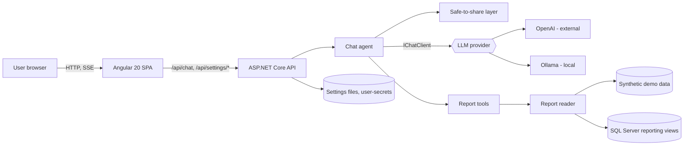
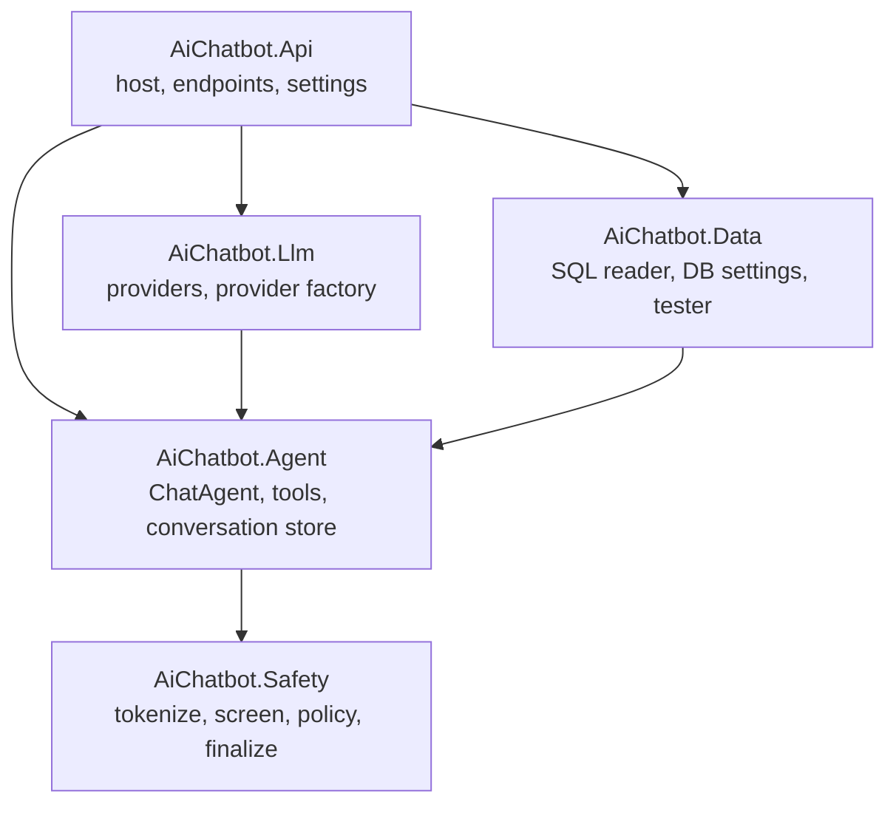
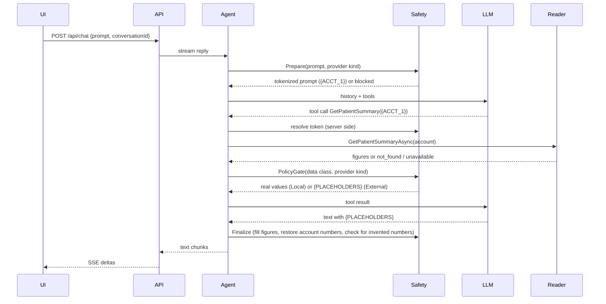

# Architecture

A chat application that answers questions about report data (patient summaries, facility metrics) with an LLM,
without letting identifiers or patient-level values reach an external model.

Related: [SQL_Reporting_Query_Layer.md](SQL_Reporting_Query_Layer.md) (data access rules),
[Data_Dictionary.md](Data_Dictionary.md) (view contract).

## 1. Goals and constraints

| Goal | Consequence for the design |
|---|---|
| Answer data questions in plain language | The LLM calls fixed tools; it never writes SQL. |
| Keep identifiers and patient-level values away from external models | One enforcement layer (Safety) in front of every model call, outside the UI and outside the prompt. |
| Swap model and data source without code changes | Provider and data source are chosen at runtime from a settings screen. |
| Small, auditable surface | Four libraries with one job each, one API host, one SPA. |

Non-goals today: per-user authentication, multi-tenant isolation, horizontal scale (see section 9).

## 2. System context

The Step 1 diagram (User Interface → API → Agent → LLM) is the spine. Safety, tools and data sit inside the agent's
boundary; settings sit beside the API.

## 3. Components and dependencies

| Project | Responsibility | Does not do |
|---|---|---|
| **Client** (Angular, standalone components, signals) | Chat view, streaming render, settings dialog (AI model, Database tabs). | Hold secrets or rules. The browser is untrusted. |
| **AiChatbot.Api** | HTTP surface, `/api/chat` streaming, protected `/api/settings/*`, composition root (DI), startup guards. | Business rules. |
| **AiChatbot.Agent** | Tool-calling loop (max 4 rounds), conversation history, `ReportTools`, `IReportDataReader` contract. | Talk to a specific vendor or database. |
| **AiChatbot.Llm** | `IChatClient` per provider, provider-kind classification, saved provider settings, model discovery. | Decide what data may be sent. |
| **AiChatbot.Safety** | Tokenization, input screen, policy gate, placeholder rendering, streaming finalizer. | Know about HTTP, vendors or SQL. |
| **AiChatbot.Data** | SQL reader over two views, DB settings (encrypted), connection tester, live-switchable reader. | Accept SQL text from anywhere. |

Dependency rule: libraries point inward to `Agent`/`Safety` contracts; only `Api` wires them together (it reaches `Safety` through `Agent`). `Safety` depends
on nothing else, so the same rules can be reused by any future API, agent or report workflow.

## 4. Chat request flow

Key behaviours:

- **Local model** (Ollama on loopback or a trusted host): streams live through the finalizer.
- **External model** (OpenAI, remote Ollama): the reply is buffered, validated, then sent once. Input is screened and
  fails closed.
- **History stores only tokenized or placeholder text**, never real values.
- **Tool failure is not "no data":** a database error becomes `unavailable`, never `not_found`.

## 5. Safe-to-share layer

Enforced in one library, in front of every model call.

| Step | Rule |
|---|---|
| Tokenize | Labelled identifiers become `{ACCT_n}` in a per-conversation vault; the model sees tokens, the server resolves them. |
| Screen (External only) | Input that looks like free-text identifiers is withheld; fail closed. |
| Policy gate | `DataClass` Public / Aggregate / PatientLevel. External: Public yes, Aggregate by option, PatientLevel never. |
| Placeholders | When data may not be shown to the model, it gets `{COUNT}`-style placeholders; the server fills real figures. |
| Finalize | Reject or list invented numbers the model produced itself. |

## 6. Data access

- Two fixed views are the **contract**: `reporting.vw_PatientSummary`, `reporting.vw_FacilityMetrics`. The reader
  issues fixed, parameterized `SELECT TOP (1)`; view names are validated identifiers.
- `IReportingSource` resolves the active source: **saved DB settings win, else configuration**.
  `SwitchableReportDataReader` follows it live, so saving in the UI applies without a restart.
- Connection details: built with `SqlConnectionStringBuilder`, remote servers forced onto TCP, 5 s connect timeout.
- **Connection test** (`DatabaseConnectionTester`): login, both views and required columns, a warning if the login can
  write; fixed messages with SQL error numbers, never the password.
- The password is encrypted at rest with ASP.NET Data Protection (`database-settings.json`, git-ignored).

## 7. Configuration and secrets

| What | Where |
|---|---|
| OpenAI API key | user-secrets (dev) or environment; saved UI settings file is git-ignored. |
| LLM settings | `settings.json` (git-ignored), via `/api/settings`. |
| Database settings | `database-settings.json` (git-ignored, password encrypted). |
| Behaviour flags | `appsettings*.json`: `Safety:*`, `Reports:*`, `Admin:ApiKey`. |

## 8. Security boundaries

| Boundary | Control |
|---|---|
| Browser to settings API | Loopback only with Host-header check (DNS rebinding), or `X-Admin-Key` when `Admin:ApiKey` is set. |
| Provider and DB targets | http(s) only, no userinfo, no link-local or metadata addresses, IPv6 zone IDs rejected. |
| Saved credentials | Reused only for the same URL or server and user; never returned to the browser. |
| Model to data | Tools only; fixed queries; token resolution on the server. |
| Production | `Reports:Provider=Sql` outside Development refuses to start without `Reports:AcknowledgeNoUserAuth=true`. |

## 9. Known gaps and roadmap

| Gap | Impact | Next step |
|---|---|---|
| No user authentication or scoping | Any caller can read any account. | Add auth (OIDC), per-user account/facility scopes in the reader. |
| Hostnames not resolved for SSRF checks | A name pointing at a blocked address passes. | Connect-time address guard; operator allowlist (`Reports:AllowedServers`). |
| Saved password reused after weaker transport flags | Turning encryption off keeps the saved password. | Include Encrypt/Trust in the reuse rule. |
| In-memory conversation store and token vault | Lost on restart; single instance only. | Persist behind `IConversationStore`; sticky or shared store for scale-out. |
| Real warehouse does not match the two views | The chat cannot answer from `MedcareDW_Dev` yet. | Write the reporting views over real tables with the data owner; extend tools for billing questions. |
| PHI handling is a fixed policy | No per-field allow/deny. | Configurable PHI policy in `Safety` with an audit log. |

## 10. Key decisions

| Decision | Why |
|---|---|
| Safety as a separate library, not UI logic or a prompt | One enforcement point for every future API, agent and workflow; prompts can be bypassed. |
| Contract views instead of table access | The model's reach is fixed and reviewable; the data owner controls the views. |
| Server fills figures from placeholders | External models never see patient-level values, and cannot misquote them. |
| Provider kind from address, not name | A remote "Ollama" is external; locality is decided by loopback or `Safety:LocalHosts`. |
| Runtime settings, not redeploy | Operators can change model and data source and test the connection first. |
| Minimal API with endpoint filters | Small surface, easy to protect a whole route group. |

## 11. Runtime and deployment

Single ASP.NET Core process (Kestrel, port 5070 in development) plus the SPA (dev server on 4200 proxying `/api`).
For production: build the SPA to static files served by the API or a CDN, run behind TLS, set `Admin:ApiKey`, use a
read-only SQL login limited to the two views, and keep secrets in the environment or a vault.
