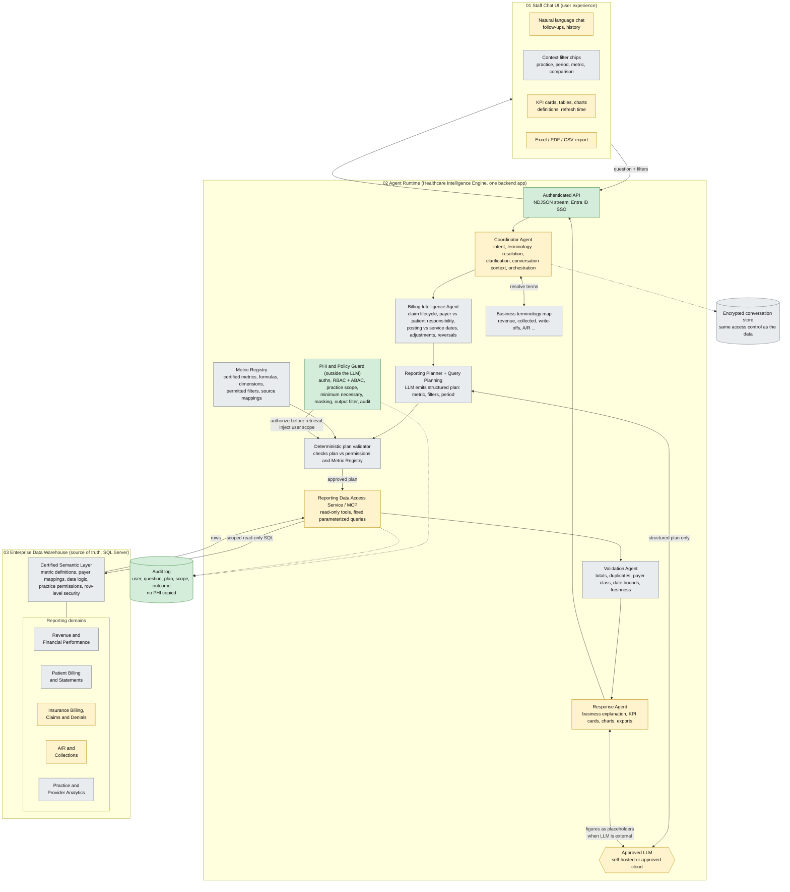

# Healthcare Revenue Intelligence Assistant: target diagram (draft)

Source: product spec, three layers, Edge Layer excluded for now. Colours show status against the current code:
green = built, amber = partial, grey = not built.

## Request lifecycle

1. Question arrives with user identity.
2. Coordinator resolves intent and terminology; asks a short clarification if the term is ambiguous.
3. Guard checks practice access and detail level, outside the LLM.
4. Planner produces a structured plan; the validator checks it against permissions and the Metric Registry.
5. Data Access Service runs approved parameterized queries scoped to the user.
6. Validation Agent checks totals, duplicates, date boundaries, freshness.
7. Response Agent returns amount, definition, refresh time and optional breakdown. Next follow-up repeats steps 3-7.

## Deployment

Logical agents, one backend process at first. No microservices.
