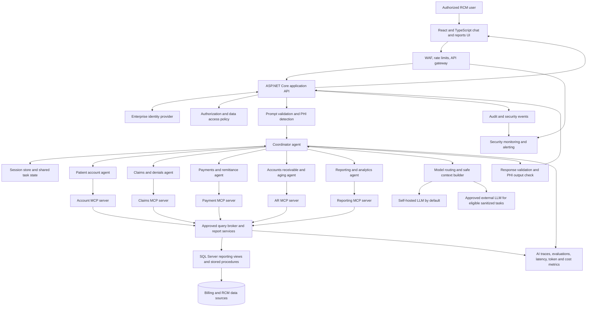
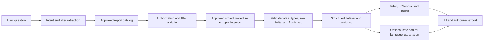

# AI Chatbot for Medical Billing, Revenue Cycle Management, and Reporting

## 1. Purpose

Build a secure conversational assistant for authorized billing, revenue cycle management (RCM), and reporting users. Users ask questions in ordinary language. The application identifies the request, checks the user's permissions, calls approved reporting tools, validates the returned data, and presents an answer with a table, KPI summary, chart, or downloadable report.

Examples:

- What is Ahmad's account statement?
- Show the top 10 insurance payers by open balance for the last 90 days.
- Explain the leading denial categories this month.
- Compare insurance payments with patient payments for the last quarter.
- Which CPT codes have the highest charge volume and payment rate?
- Show claims that remain unpaid and group them by payer and aging band.

This is a proposed RCM architecture based on the stages and engineering concerns described in the supplied video transcript. The banking examples in the video have been translated into healthcare billing domains. RCM-specific workflows, metric definitions, data mappings, and permissions must still be confirmed against the actual billing system and data dictionary.

## 2. Architecture principles taken from the video

1. Begin with a simple chat interface and backend API, then connect the assistant to approved business tools.
2. Do not attach an unlimited number of unrelated tools to one agent. Separate tools into business domains as the system grows.
3. Use a coordinator to plan multi-part questions and route work to the appropriate domain agents.
4. Use Model Context Protocol (MCP) servers to keep tool integration, input validation, API calls, and error handling separate from agent reasoning.
5. Authenticate the person asking the question and authorize every requested data operation. Never trust a patient name or identifier supplied in chat as proof of identity or access.
6. Store conversation history and bounded shared state when later turns depend on earlier turns.
7. Detect and reduce protected health information (PHI) before data is sent to a language model. Use a self-hosted model by default where practical, and only use an approved external model for permitted, sanitized tasks.
8. Maintain a golden evaluation set for realistic prompts and edge cases. Re-run it after prompt, model, tool, or report changes.
9. Trace the full AI request path, including routing, agent calls, tool calls, parameters, results metadata, model usage, latency, errors, and cost.
10. Protect the public entry point with a web application firewall (WAF), rate limits, gateway policies, and identity integration.

The video presents these as a progression from a demo chatbot to a production architecture. The sections below apply that progression to an RCM reporting application.

## 3. Scope and operating boundary

### First release

- Internal staff chatbot for approved billing and RCM users.
- Read-only patient account, claim, payment, adjustment, denial, payer, provider, and CPT reporting.
- Approved report catalog and governed metric definitions.
- Structured answers, data tables, KPI cards, charts, and Excel or PDF export.
- Evidence for each result: filters, reporting period, source view or report definition, calculation definition, row count, and data freshness.
- User-level audit trail and AI evaluation pipeline.

### Later release, only after approval

- Draft a claim follow-up task or denial appeal for staff review.
- Submit an approved operational action after explicit confirmation and authorization.
- Add carefully controlled patient-facing functionality through a separate user experience and identity policy.

### Out of scope for the first release

- Arbitrary text-to-SQL execution against production tables.
- Unreviewed updates to balances, adjustments, claims, payments, or patient demographics.
- Automatic write-offs, payment posting, claim submission, or changes to financial records without an approved workflow.
- Sending raw patient records or full statements to an external model.

Internal RCM staff and patients should not share the same authorization model. If patient-facing chat is added, use a separate policy boundary, identity journey, and release gate.

## 4. Recommended high-level architecture



### Trust boundaries

- **Browser boundary:** The browser is not trusted to choose a patient, tenant, database role, or permission scope.
- **Application boundary:** Authentication, authorization, input checks, tool allowlists, and query policies run in trusted backend services.
- **Data boundary:** SQL access is restricted to approved reporting views and stored procedures. The chatbot does not receive a general production database credential.
- **Model boundary:** Only the minimum context needed for reasoning is sent to a model. PHI-bearing data stays inside the approved processing boundary unless a formal policy explicitly allows a controlled transfer.
- **Export boundary:** Report downloads are separately authorized, audited, time-limited where appropriate, and subject to the same data scope as on-screen results.

## 5. Request flow

1. The user signs in through the enterprise identity provider.
2. The frontend sends the message and session reference to the application API. It does not send a user ID that the backend blindly trusts.
3. The API validates the session, obtains the authenticated actor, applies rate limits, and checks the actor's role, tenant, facility, and permitted data scope.
4. The input guard identifies sensitive identifiers, unexpected instructions, malformed content, and unsupported requests. It masks or tokenizes unnecessary PHI before model use.
5. The coordinator classifies the intent and creates a bounded execution plan. For a simple request, it calls one specialist. For a combined request, it can call several specialists and combine their verified outputs.
6. The selected specialist uses only its domain's allowlisted MCP tools.
7. The MCP server validates the request against a typed schema, applies authorization context, calls an approved API, stored procedure, or report service, handles errors, and returns a structured result.
8. The query broker executes a read-only query against approved reporting objects. Exact amounts, balances, counts, percentages, and aging calculations are computed by SQL or deterministic application code, not invented by the LLM.
9. The result validator checks data shape, filters, freshness, row limits, metric definitions, and whether the result supports the question.
10. The response layer renders exact values and records in the UI. The LLM may explain the result using minimized context, but it is not the source of financial truth.
11. An output guard checks for unintended PHI disclosure and unsupported claims before the response is returned.
12. The system records a protected audit and trace record, including relevant decision metadata, tool names, result metadata, timing, model usage, and cost. Sensitive raw values are not copied into general application logs.

## 6. Application components and responsibilities

| Component | Responsibility | Must not do |
|---|---|---|
| Chat UI | Conversation, suggested prompts, tables, charts, report filters, exports | Make authorization decisions or connect directly to SQL Server |
| Application API | Sessions, identity context, request validation, response shaping, export authorization | Trust identity fields supplied by the browser |
| Policy service | Role and attribute checks for users, patients, facilities, reports, and exports | Let the LLM decide whether access is allowed |
| Input guard | Detect PHI, mask unnecessary identifiers, check prompt size, reject unsafe payloads | Treat redaction as a substitute for authorization |
| Coordinator agent | Classify intent, plan a bounded workflow, route to domain agents, combine verified results | Execute SQL or invent report definitions |
| Domain agent | Understand a bounded business domain and select from its limited tool set | Access tools from unrelated domains by default |
| MCP server | Expose typed tools, validate parameters, call system APIs, normalize errors and responses | Hold unrestricted database access or bypass policies |
| Query broker | Select approved report definitions, views, and stored procedures; enforce limits | Execute arbitrary model-generated SQL |
| Report engine | Apply approved metrics, grouping, date windows, formatting, and export rules | Change financial definitions based on prompt wording alone |
| Session store | Keep conversation history and task state scoped to one user and tenant | Share conversation state across users or tenants |
| Audit and observability | Record access decisions, traces, tool calls, failures, cost, and system health | Store unnecessary raw PHI in general logs |
| Evaluation service | Run golden prompts and check tool choice, data correctness, safety, and response quality | Depend only on subjective manual review |

## 7. Domain-specific agent design

The video separates account, transaction, and service agents. For RCM, use business domains that reflect how billing data is owned and reported.

### A. Patient Account Agent

Example questions:

- What is the account statement for this patient?
- Break down the balance into insurance and patient responsibility.
- Show charges, payments, adjustments, and current open balance for the approved period.

Tools should include patient search within the requester's permitted scope, account summary, ledger lines, statement data, and balance composition. Patient resolution must handle duplicate names and must not disclose data from a name match alone.

### B. Claims and Denials Agent

Example questions:

- Which claims were denied in the last 30 days?
- What are the leading denial categories by payer?
- Which denied claims need follow-up based on the configured work queue?

Tools should include claim status, denial details, denial reason mapping, payer response details, and appeal or follow-up deadlines when present in the approved source data. The agent must distinguish source values from explanatory interpretation.

### C. Payments and Remittance Agent

Example questions:

- Show payments by payer for the last month.
- Compare insurance payments with patient payments.
- Summarize ERA payments, adjustments, and posting dates.

Tools should read payment records, remittance details, posting dates, source types, and adjustment details. Payment source labels and adjustment mappings must come from an approved data dictionary rather than model inference.

### D. Accounts Receivable and Aging Agent

Example questions:

- Show open insurance balances by payer and aging band.
- Which providers have the largest overdue balance?
- List accounts with no payment for more than 90 days.

Tools should apply the approved aging date, status rules, payer scope, and open-balance logic. The definition of an insurance-only balance must exclude records with no open insurance responsibility when that is the report's documented rule.

### E. Reporting and Analytics Agent

Example questions:

- Show the top 10 payers by open balance over the last 90 days.
- Create a denial analysis report grouped by payer and denial category.
- Show CPT performance by charge count, allowed amount, payment, adjustment, and open balance.

Tools should use the governed report catalog and approved metric definitions. This agent can request a dataset, then return its metadata to the UI report engine for charts and exports.

### F. Optional Workflow Agent

Reserve for a later release. It may create a draft follow-up task or prepare a draft appeal. Any action that changes a financial or patient record requires a separate permission check, a confirmation step, idempotency protection, and an auditable transaction. Keep read-only reporting separate from write operations.

### Why use multiple agents?

Specialist agents reduce tool confusion and allow separate ownership, testing, and permissions. A coordinator is needed when a question spans multiple domains, such as asking for an account balance and the last five payments. However, multi-agent architecture adds cost and failure paths. Start with clearly separated tool groups and introduce agent autonomy only when it solves a demonstrated routing or workflow problem.

## 8. MCP server boundaries

Create one MCP server per domain when ownership, deployment, security, or tool count justifies separation. The logical boundaries can exist as modules in one deployable service during the first release.

- **Account MCP:** account summary, statement lines, ledger totals, balance composition.
- **Claims MCP:** claim status, claim details, denials, denial reason lookup, appeal deadlines.
- **Payment MCP:** payment search, remittance details, payment source mappings, adjustment summaries.
- **AR MCP:** open balances, aging bands, payer and provider balances, overdue worklists.
- **Reporting MCP:** report catalog, validated report execution, metric definitions, export preparation.

Every tool needs a name, description, typed input schema, allowed caller roles, required data scope, output schema, maximum row count, timeout, and normalized error codes. MCP is an integration boundary, not a security product by itself. Authentication, authorization, validation, network controls, and auditing must still be implemented in the server and surrounding platform.

## 9. Governed reporting pipeline



### Rules for reliable financial answers

- Use only approved views, stored procedures, or parameterized query templates.
- Never execute raw SQL generated directly by the LLM.
- Define report metrics in a catalog with business owner, formula, inclusions, exclusions, date basis, grouping fields, and effective version.
- Require an explicit date range or apply a clearly displayed documented default.
- Show whether a report uses service date, posting date, deposit date, aging date, or another date field.
- Distinguish charges, payments, contractual adjustments, write-offs, refunds, and outstanding balances.
- Include filters, reporting period, refresh time, source objects, row count, and metric version in the result metadata.
- Apply row limits and pagination. Large reports should use an asynchronous export job rather than returning every row in the chat response.
- If data is missing, ambiguous, stale, or inconsistent, say so instead of filling gaps.
- Use deterministic code for sums, rates, balances, and comparisons. The language model may explain the computed result but cannot alter it.

### Initial report catalog

| Report | Required inputs | Output |
|---|---|---|
| Patient account statement | Authorized patient or account key, date range | Charges, payments, adjustments, responsibility, and open balance |
| Insurance AR aging | As-of date, payer, provider, aging bands | Open insurance balance by payer, provider, and aging band |
| Denial analysis | Posting or adjudication date basis, payer, category | Denial count, amount, category breakdown, and trend |
| Payments by payer | Posting date range, payer, payment source | Payment totals and record counts by payer and source |
| Insurance versus patient payments | Date basis, period, payer or provider filters | Separately defined insurance and patient payment totals |
| CPT performance | Date basis, CPT, payer, provider, period | Charge volume and approved payment, adjustment, and balance measures |
| Claim status and throughput | Date range, status, payer | Counts and balances by claim state and processing period |
| Account balance summary | Authorized account scope, as-of date | Total and component balances with calculation definitions |

Metric formulas must be signed off by the RCM business owner before production. Similar names can hide different business rules, especially for net collections, denial rate, clean claim rate, and days in AR.

## 10. Example: "What is Ahmad's account statement?"

1. The API obtains the authenticated staff member's identity and data scope. The name Ahmad does not grant access.
2. The Account Agent requests a scoped patient search tool. The backend returns only matches that the user is permitted to see.
3. If there are multiple matches, the bot asks for an approved disambiguating detail or asks the user to select a permitted result. It does not reveal extra demographics merely to resolve ambiguity.
4. Once the patient or account is safely resolved, the tool retrieves statement lines from approved reporting objects.
5. The report service computes totals and checks that line items reconcile under the agreed statement rules.
6. The UI renders the exact statement table and balance summary directly from the structured result. The full statement is not sent to the LLM by default.
7. The LLM may provide a brief explanation using minimized or de-identified totals, if policy allows.
8. The application audits access and export events. A downloaded statement receives the same authorization checks as the on-screen result.

If the user is a patient rather than an authorized internal employee, the workflow must use the patient's verified identity and its own access policy. A first name, account number, or patient ID typed into chat is never sufficient authentication.

## 11. Identity, authorization, and privacy controls

### Authentication

- Integrate with the organization's identity provider using a supported standard such as OpenID Connect or OAuth 2.0.
- Use short-lived access tokens or secure server-managed sessions, appropriate session expiration, and secure cookie settings where applicable.
- Bind the authenticated actor to every request on the server. Do not accept a user ID, role, or tenant from model output or untrusted client fields.

### Authorization

- Apply role-based and attribute-based checks for user role, tenant, facility, provider, payer, patient scope, report type, and export permission.
- Re-check permissions for every tool call and export, not only when the chat session starts.
- Enforce data scope in the query broker and database layer where supported. UI filtering is not a security control.
- Use separate read-only database identities and least-privilege permissions.
- Require separate permissions and explicit confirmation for future write actions.

### PHI handling

- Detect and minimize PHI in user prompts before model calls.
- Prefer opaque internal references or tokenized identifiers over names, dates of birth, member IDs, and other direct identifiers in reasoning context.
- Keep exact patient data inside authorized application services and render it directly from controlled result objects when possible.
- Apply output screening before returning content or creating exports.
- Do not put raw prompts, full SQL result rows, patient names, claim identifiers, or statement lines in ordinary logs by default.
- Set retention limits and access controls for conversation history, audit data, exports, traces, and backups.
- Encrypt traffic and stored data, manage secrets through a secret manager, and restrict model and MCP network egress.
- Treat user documents, database text, and tool results as untrusted data. They must not be allowed to override system policy or invoke new tools.

PHI detection and masking reduce risk but do not replace access control, approved data processing agreements, vendor review, threat modelling, or the organization's privacy and security review. Self-hosting also does not automatically make a system secure or compliant.

## 12. Model routing strategy

### Default path

Use a self-hosted model inside the organization's controlled environment for routine intent classification, tool selection assistance, clarification, and low-risk summaries, where the model performs well enough on the evaluation suite.

### External model path

An external model may be used only if it is approved by the organization, the specific task is allowed by policy, and the context has been minimized and screened. Do not send raw PHI simply because the task is complex. If the task cannot be safely sanitized, keep it local or fail closed with a clear response.

### Model safety rules

- The model proposes tool calls; the application validates and executes them.
- Tool schemas allow only expected fields, formats, enumerations, date ranges, and row limits.
- Model output cannot grant permissions, choose an unverified patient, change a metric formula, or bypass approval.
- Add timeouts, retry limits, fallback responses, and deterministic handling for common intents.
- Maintain model version, prompt version, routing reason, and evaluation results.

## 13. Conversation history and shared state

The video highlights that language models do not automatically remember earlier turns. For RCM, use a session store with explicit boundaries.

Store only what is required:

- Conversation messages, with sensitive values redacted or stored under a stricter policy.
- Current task state, such as selected report, permitted date range, and clarified filter values.
- A small summary of prior turns when needed to answer follow-up questions.
- Inter-agent results as typed references and metadata, not unrestricted copied patient data.

Every state item must be scoped to the authenticated user, tenant, and session. Use expiration, access controls, data minimization, and an explicit deletion or retention policy. Never let one user's conversation memory become available to another user. Before using stored context, re-check current authorization.

## 14. Evaluation and regression testing

Build a golden dataset before production and keep it under version control. It should cover both expected requests and adversarial or ambiguous cases.

Test groups:

- Correct intent and report selection.
- Correct tool selection and parameter extraction.
- Accurate totals against known database fixtures.
- Date filters, time zones, posting versus service date, aging date, and empty result sets.
- Duplicate patient names and unauthorized patient access.
- Cross-tenant, cross-facility, and cross-role access attempts.
- Prompt injection in user text and retrieved database content.
- PHI redaction, safe output, and model routing restrictions.
- Multi-domain questions requiring coordinator planning.
- MCP errors, timeouts, missing fields, malformed responses, and duplicate requests.
- Regression checks after model, prompt, tool schema, or metric definition changes.

Measure exact data correctness separately from language quality. A polished explanation is a failure if the underlying amounts, filters, patient scope, or report selection are wrong.

## 15. Observability, support, and AI cost controls

For each request, create a correlation ID and trace the end-to-end path. Record:

- Authenticated actor reference, role, tenant or facility scope, and authorization outcome, without unnecessary patient identifiers.
- Request timestamp, latency, response status, and failure category.
- Intent classification and coordinator plan version.
- Agent and MCP tool names, validated parameter metadata, call duration, result status, and row count.
- Report definition and metric version, filters, date basis, and data freshness.
- Model provider, model version, token counts, duration, retry count, and estimated cost.
- Evaluation outcome and safety decisions where available.
- Application health, CPU, memory, disk, network, database connection pool, query latency, and error rates.

Do not store sensitive payloads in general logs by default. Where debugging requires content capture, use an access-controlled, time-limited mechanism with redaction, audit trails, and formal approval. Alerts should detect abnormal error rates, repeated denied access, unusual export volume, model cost spikes, slow queries, and unexpected model routing.

## 16. Edge and infrastructure security

- WAF rules against common web attacks and abusive request patterns.
- Per-user, per-session, and per-IP rate limits, with tighter limits for expensive report and export endpoints.
- API gateway policy enforcement for authentication, token checks, request size, allowed routes, timeouts, and quotas.
- Private network access to SQL Server and MCP services. Do not expose internal data services directly to the internet.
- Secrets management, key rotation, TLS, encryption at rest, vulnerability scanning, dependency updates, and backup recovery tests.
- Separate development, test, staging, and production environments with synthetic data outside production.
- Centralized security alerts and an incident response runbook.

## 17. Suggested technology stack

| Layer | Suggested technology | Notes |
|---|---|---|
| Frontend | React, TypeScript, Tailwind CSS | Chat, report filters, KPI cards, tables, charts, export status |
| Application API | ASP.NET Core Web API | Strong fit for enterprise identity, policy enforcement, and SQL Server integration |
| Orchestration | Dedicated coordinator service or module | Bounded plans, domain routing, tool budgets, cancellation, and safe fallbacks |
| MCP | Domain-specific MCP servers or modular MCP endpoints | Separate tool integration from agent reasoning |
| Reporting | SQL Server reporting database, approved views, stored procedures, report catalog | Read-only credentials and deterministic metrics |
| Session state | SQL Server or Redis, selected based on retention and operational needs | User and tenant scoped state with TTL and deletion policy |
| Local model | Approved self-hosted LLM runtime | Must pass the RCM evaluation and capacity tests |
| External model | Approved provider behind a model router | Only eligible sanitized requests under policy |
| Exports | Server-side Excel and PDF generation | Authorization checked again at export time |
| Observability | OpenTelemetry-compatible traces, metrics, and logs | Redaction and restricted access are mandatory |
| Deployment | Private network, containerized services where supported, managed secrets | Final choices depend on the organization's hosting standards |

This is a reference stack, not a claim that these products were mentioned by the video speaker.

## 18. Suggested repository layout

```text
rcm-ai-assistant/
  apps/
    web/                      React and TypeScript UI
    api/                      ASP.NET Core application API
  services/
    coordinator/               Planning and domain routing
    model-router/              Local and approved external model routing
    input-guard/                PHI checks and prompt validation
    query-broker/               Approved report execution
    report-engine/              Metric calculation and export jobs
    evaluation/                 Golden set runner and scorecards
  mcp/
    account/                    Account tools
    claims/                     Claim and denial tools
    payments/                   Payment and remittance tools
    ar/                         Aging and open balance tools
    reporting/                  Catalog and report execution tools
  contracts/
    tools/                      Typed tool request and response schemas
    reports/                    Versioned report and metric definitions
    policies/                   Roles, actions, and data scope definitions
  data/
    reporting-views/             SQL views and stored procedures
    dictionaries/                Source mappings and business definitions
    fixtures/                    Synthetic test data only
  tests/
    unit/
    integration/
    authorization/
    security/
    ai-evaluation/
  deploy/
    local/
    test/
    staging/
    production/
  docs/
    architecture.md
    threat-model.md
    report-catalog.md
    runbooks.md
```

Keep secrets, production extracts, PHI fixtures, and environment-specific connection strings out of source control.

## 19. Delivery roadmap

### Phase 0: Confirm the data and rules

- Inventory the source systems, schemas, reporting views, and existing APIs.
- Validate patient account, claim, payment, adjustment, denial, payer, provider, and CPT mappings.
- Agree on authoritative definitions for open balance, insurance responsibility, payment source, denial amount, aging date, and each KPI.
- Define role and data-scope rules with RCM, privacy, security, and data owners.

**Exit condition:** Approved data map, metric catalog, access matrix, and threat model.

### Phase 1: Secure reporting foundation

- Build read-only reporting views or stored procedures.
- Implement identity integration, authorization checks, audit events, row limits, and export controls.
- Build a non-AI report API and validate totals against known examples.

**Exit condition:** Reports are accurate and access-controlled without an LLM.

### Phase 2: Basic chatbot with governed tools

- Add the chat UI, API, input guard, coordinator, and a small catalog of read-only tools.
- Support clarification questions, structured result rendering, and evidence metadata.
- Keep a single coordinator with bounded tool groups until complexity justifies specialized agents.

**Exit condition:** The bot answers a limited set of questions with correct results and safe fallbacks.

### Phase 3: Domain agents and MCP separation

- Split account, claims and denials, payments, AR, and reporting tool groups.
- Add a coordinator plan for questions that span more than one domain.
- Move integration details, parameter validation, errors, and API-specific handling into MCP servers.

**Exit condition:** Cross-domain requests are traceable, permission checked, and regression tested.

### Phase 4: Session context and PHI protection

- Add scoped conversation history and shared task state.
- Add input and output PHI safeguards and the model routing policy.
- Verify no raw patient data reaches a model path that is not approved for it.

**Exit condition:** Privacy and security tests pass for supported user journeys.

### Phase 5: Evaluation, observability, and cost limits

- Add the golden test set and automated regression runs.
- Trace agent and MCP decisions, query metadata, latency, errors, and model cost.
- Add alerts, dashboards, support runbooks, and safe fallback behavior.

**Exit condition:** Operations can explain failures, detect regressions, and control cost.

### Phase 6: Controlled operational actions

- Add draft follow-up tasks or appeal preparation only after read-only reporting is stable.
- Require explicit user confirmation, role authorization, duplicate prevention, and audit logging before any write operation.

**Exit condition:** Every write action has an approved business workflow, permission model, and rollback or correction procedure.

## 20. Minimum acceptance criteria

- A user cannot retrieve a patient statement solely by supplying a name, account number, or patient ID.
- Changing a browser field or prompt cannot change the authenticated identity or permitted data scope.
- Every report uses an approved definition and reports its date basis and filters.
- Exact financial values come from deterministic reporting services, not model-generated arithmetic.
- No arbitrary LLM-generated SQL executes against production.
- Every tool call is schema validated, authorized, bounded by row and time limits, and audited.
- Multi-agent requests preserve one user scope across every sub-agent and MCP call.
- Session memory cannot cross users, tenants, or facilities.
- PHI is not sent to an unapproved external model, and sensitive logs are minimized.
- Golden tests cover accuracy, permissions, ambiguity, prompt injection, tool failures, and model changes.
- Operations can trace a request from user message through agent routing, tool selection, report execution, and final response using a correlation ID.
- Model token use and estimated cost are tracked, and configured budgets or quotas can stop runaway usage.
- Export endpoints re-check permissions and record access.
- Read-only reporting remains functional when the model is unavailable for a safe, supported report path where feasible.

## 21. Key implementation decisions to settle before coding

1. Is the first audience internal billing and RCM staff, or patients as well? The safer first release is internal staff only.
2. Which database and report views are authoritative, and which date fields govern each report?
3. Which roles can see identifiable patient information, export statements, and access cross-facility reports?
4. Which LLMs are approved for the organization's data classification, and which tasks must stay fully local?
5. Which reports are required for the first release, and who approves their formulas?
6. Does the current billing system expose supported APIs, or will the query broker use SQL Server reporting views and stored procedures?
7. What audit retention, conversation retention, export retention, and incident response rules apply?

## Final recommendation

Build the reporting foundation first, then place a guarded conversational layer over it. Use the coordinator and domain tool boundaries from the video, but keep the financial data path deterministic and permission controlled. Add MCP to separate integration concerns, conversation state for follow-up context, PHI safeguards before model calls, a golden evaluation suite, end-to-end traces, cost limits, and edge security before production. Multi-agent reasoning should coordinate approved tools, never become a shortcut around the reporting, security, or audit layers.
